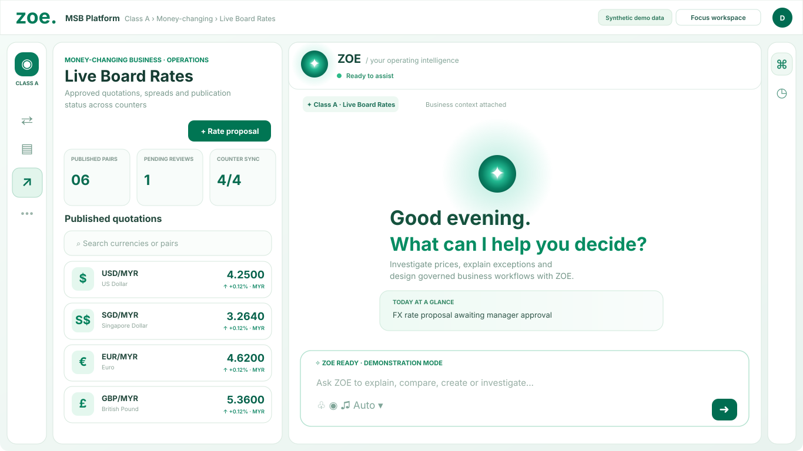
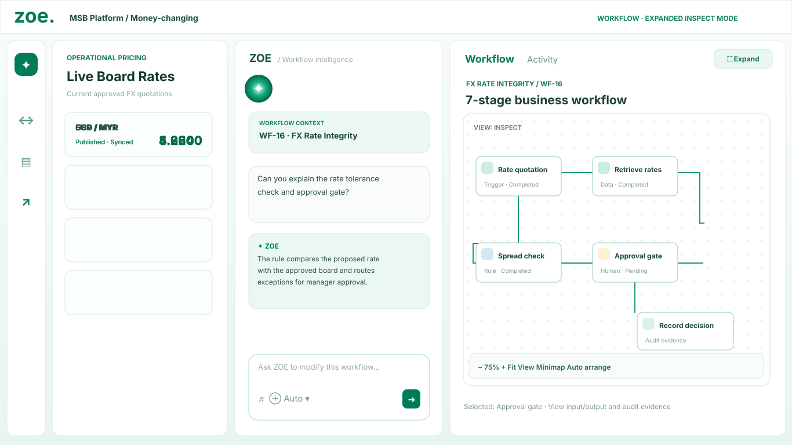

# ZOE Agentarium — Premium UI Prototype

A **chat-first, premium light-theme** ZOE MSB workspace for a 14-inch laptop. This is an isolated preview on the `zoe-ui-preview` branch; it does **not** replace or deploy the main application.

## Open the interactive prototype

**[View `index.html` on GitHub](./index.html)** — on the GitHub file page, use **Download raw file** (down-arrow) to save it, or clone this branch and run it locally.

- **[Open the implementation master prompt](./IMPLEMENTATION_PROMPT.md)** — React Flow + React Flow UI + ELKjs, AI workflow proposals, approvals, refined glowing chat and responsive panels.
- **[Raw HTML file](https://raw.githubusercontent.com/GokulJS12/pureai/zoe-ui-preview/zoe-preview/index.html)** — use Save As if the browser displays source text.

### Visual previews

These are **illustrative vector previews** of the interface design, not screenshots of a connected production application.

**Chat-first 14-inch desktop layout**



**Expanded workflow inspection layout**



## Run on Ubuntu

```bash
git clone --single-branch --branch zoe-ui-preview https://github.com/GokulJS12/pureai.git
cd pureai/zoe-preview
python3 -m http.server 8080
```

Then open [http://127.0.0.1:8080](http://127.0.0.1:8080) in Chrome or Firefox.

You can also download only `index.html` and open it locally, but a local server is preferable for testing embedded routes.

## Important boundaries

- This is a **front-end demonstration** with synthetic business data and simulated chat/actions; it is not a connected financial system.
- The Flow Foundry route in the prototype refers to a separate local development service: `http://127.0.0.1:5175/msb/class/A/workflows/WF-16-`. Confirm the real workflow URL. The service must be running on your machine, and iframe embedding must be allowed.
- **React Flow + ELKjs are proposed in the master prompt, not installed or implemented by this HTML prototype.**
- The layout reference prioritizes ZOE conversation and allows operational/workflow panels to expand on demand.
- No changes were made to the existing branch by this preview upload.

## Files

| File | Description |
| --- | --- |
| [index.html](./index.html) | Standalone interactive UI prototype |
| [IMPLEMENTATION_PROMPT.md](./IMPLEMENTATION_PROMPT.md) | Detailed Antigravity / Codex integration guide |
| [previews/chat-first-desktop.svg](./previews/chat-first-desktop.svg) | Static vector preview — chat-first |
| [previews/flow-foundry-inspect.svg](./previews/flow-foundry-inspect.svg) | Static vector preview — workflow canvas |

